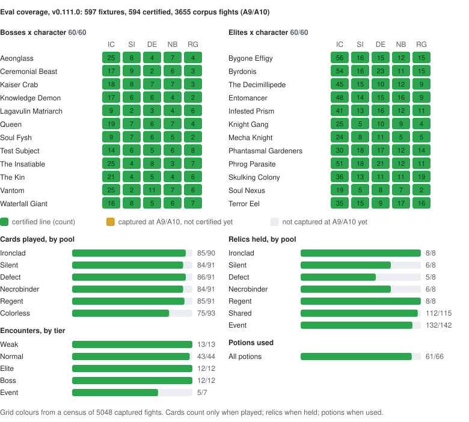

# v0.111.0 eval fixture set


This directory contains real fights that players recorded in the game.
Each fight is for game build v0.111.0 (refer to `sim/meta/SIM_VERSIONING.md`).

The directory has two sets:

* **The fixture set** (`fights/`, `manifest.json`). CI checks this set on each engine change.
* **The corpus** (`corpus/`). This is a larger set of certified fights. CI does not run it.

The engine is correct when it agrees with the checksums in the capture.
The game writes one checksum after each action.
The tools measure this agreement with the release binary of the engine.

## Coverage



`eval_coverage.py` measures how much of the game the **certified** fights use.
It counts the certified fixtures and the corpus fights together.
Each axis has one rule:

* A card counts when a player **plays** it.
* A relic counts when the player **holds** it at the start of a fight.
* A potion counts when a player **uses** it.
* An encounter counts for its tier.

The grid shows each boss and each elite for each character.
The grid shows empty cells also. The color of an empty cell gives the cause:

* **Amber:** an A9 or A10 capture exists, but it is not certified. This is engine work.
* **Grey:** no A9 or A10 capture exists. A player must record this fight.

The amber and grey data comes from a census of the capture collection.
The capture collection is not in this repository.
Thus `coverage.json` keeps this data, and the tool uses it again.

The tool writes three files: `coverage.json`, `COVERAGE.svg` and `coverage-badge.svg`.
`seed` writes the three files and measures the amber and grey data again.
`add` writes the three files from the data in `coverage.json`.
The test `test_coverage_artifacts_are_fresh` fails when the files are not current.

`coverage_universe.json` is a copy of the reference lists.
The sources of these lists are:

* Cards and their pools: `data/cards.json` and the `colors` list in `data/game_values.json`.
* Relics: `data/relics.json`.
* Potions and encounter titles: `data/loc_en.json`.
* Encounters and tiers: `engine/ENCOUNTER_COVERAGE_CENSUS.json`.

Make the copy again when the game build changes:

```bash
python3 sim/v0.111.0/eval/eval_coverage.py                    # write the files
python3 sim/v0.111.0/eval/eval_coverage.py --census C.json    # also measure amber and grey
python3 sim/v0.111.0/eval/eval_coverage.py --refresh-universe # copy the reference lists
python3 sim/v0.111.0/eval/eval_coverage.py --check            # fail if a file is not current
```

## Layout

```
manifest.json                       all fixtures: id, kind, categories, provenance, results
fights/<id>/provenance.json         seed, node, encounter, character, ascension, build, two sha256 values
fights/<id>/entry.canonical.json    the initial state of the fight (sts-sim-canonical-v2)
fights/<id>/human_line.json         the actions of the player, a digest after each action, the final state
fights/<id>/refusal.json            for a refusal fixture: surface, class, the refusal text, all blockers
fights/<id>/capture.mcr.gz          the replay file of the game for the fight, with gzip compression
fights/<id>/entry.save.gz           the save that gives the initial state, with gzip compression
corpus/index.json                   all certified A9 and A10 fights, with a path for each
corpus/fights/<id>/provenance.json  the same fields as a fixture
corpus/fights/<id>/capture.mcr.gz   the replay file of the game for the fight
corpus/fights/<id>/entry.save.gz    the save that gives the initial state
```

An `<id>` is an opaque identifier. It is not a file name.

### The capture pair

Each fixture keeps the two files that made it:

* `capture.mcr.gz` is the `.mcr` replay of the game. It contains a checksum after each action.
* `entry.save.gz` is the entry save.

`provenance.json` gives the sha256 of each file before compression.
The fields are `capture_sha256` and `save_sha256`.
This command prints the recorded value: `gunzip -c capture.mcr.gz | shasum -a 256`.

`test_eval_suite.py` makes sure that each line fixture has its pair.
It also makes sure that each file agrees with its recorded sha256.

Some saves have `"entry_input": "--capture-run"` in the provenance.
Such a save comes from an uploaded capture (refer to `import-uploads`).
The engine reads it with `--capture-run`, not `--save`.

A refusal fixture for a capture with no save keeps only the capture.

The 597 fixture pairs use 14.1 MB after compression.

## The corpus

The corpus contains each A9 and A10 fight from the site uploads that is certified.
A fight is certified when the engine agrees with all checksums in the capture.
The corpus does not contain a fight that fails.

The corpus is a resource for work on the engine and on the solver.
CI does not run the corpus. Run it when you need it.

`corpus/index.json` lists 4,205 fights:

* 3,655 fights are in `corpus/fights/`.
* 550 fights are fixtures. The index gives their path in `fights/`.

The fights were certified at monorepo commit `d0b2bc633`.
The 3,655 corpus pairs use 87.2 MB after compression.

For each fight, the index gives these fields:

* `id`, `character`, `ascension`, `encounter`, `node_type`, `turns`, `won`
* `path`: the directory of the fight
* `cards_played`, `relics_held`, `potions_used`: the data that `eval_coverage.py` counts

The index does not give these three fields for a fight that is a fixture.
A corpus fight has no `entry.canonical.json` and no `human_line.json`.
The engine makes them again from the pair.

### How to run the corpus

1. Build the engine:

   ```bash
   cargo build --locked --release --manifest-path sim/v0.111.0/engine/Cargo.toml --bin sts-sim
   ```

2. Put the pairs in a work directory:

   ```bash
   python3 - <<'PY'
   import json, pathlib, sys
   sys.path.insert(0, "sim/v0.111.0/engine/tools")
   import eval_suite
   corpus = pathlib.Path("sim/v0.111.0/eval/corpus")
   out = pathlib.Path("/tmp/sts2-corpus/uploads")
   out.mkdir(parents=True, exist_ok=True)
   for fight in json.loads((corpus / "index.json").read_text())["fights"]:
       directory = (corpus / fight["path"]).resolve()
       provenance = json.loads((directory / "provenance.json").read_text())
       eval_suite.materialize_pair(directory, provenance, out)
   PY
   ```

3. Run the census on the work directory:

   ```bash
   python3 sim/v0.111.0/engine/tools/eval_suite.py census --captures /tmp/sts2-corpus/uploads
   ```

The census must certify each fight. If a fight is not certified, the engine has a defect.

## How to check the fixtures against the game

```bash
cargo build --locked --release --manifest-path sim/v0.111.0/engine/Cargo.toml --bin sts-sim
python3 sim/v0.111.0/engine/tools/eval_suite.py census --fixtures
```

`census --fixtures` does these steps:

1. It compares each stored file with its recorded sha256.
2. It builds the initial state from the save with the engine.
3. It plays the recorded actions from the capture.
4. It compares the engine with each checksum in the capture.

It does not read `entry.canonical.json` or `human_line.json`.
Thus the result compares the engine with the game, not with stored engine output.

The command prints the census table and then one line:

```
stored pairs: 594 certified of 597 fixtures; the manifest records 594 certified: reproduced
```

The command fails in these conditions:

* A fixture does not get the `lockstep` result that the manifest records.
* A stored file is absent.
* A stored file has incorrect bytes.

The command takes approximately seven minutes.
One Knights fight (`f88b91747240e7af`, #3581) takes five of these minutes.
`--progress` prints a report after each 50 fixtures.

The `census` block in the manifest gives a different number.
That number is for the capture collection from which `seed` made the fixtures.
You cannot reproduce it from this repository.

For an event fight, a later save at the same node records the encounter.
The pair cannot give the encounter.
For these fixtures, the census reads the encounter from `provenance.json`.

## Kinds and categories

* `line`: the engine accepts the initial state, and the recorded actions play correctly.
* `certified`: a `line` fixture for which all checksums agree.
* `refusal`: the engine refuses the fight. The fixture records the surface and the cause.

The refusal surfaces are, in sequence: `capture-pairing`, `rust-entry`, `rust-opening`,
`rust-load`, `rust-line` and `rust-lockstep`.

* `rust-line`: a recorded input has no exact engine action.
* `rust-lockstep`: a checksum does not agree.

A refusal fixture is a test in two directions.
When the engine starts to accept the fight, the test
`test_uncertified_roots_still_refuse_for_the_recorded_reason` fails.
Then you must run `seed` or `add` again.

The other categories are:

* `node:monster`, `node:elite`, `node:boss`: the room type.
* `human`: the fight is an A9 or A10 fight with the actions of a player.
  Use only these fights to compare a solver with a player.

Each character has a boss line and an elite line.
The exceptions are in `test_eval_suite.KNOWN_LINE_GAPS`.

## How the tools certify a fight (#2999)

All steps use only the Rust engine.

1. **Initial state.** `sts-sim entry --save --opening` builds the initial state.
   The tool compares it with the first checksum in the capture.
   The fields `opening_checkpoint`, `opening_rng_drift` and `opening_counter_drift` give the result.
2. **Recorded actions.** The tool changes each recorded input into one engine action.
   It uses the same code as the fight review (`python/rust_replay.py`, #2988).
   The result `human` is `exact` when each input has an action and the fight stops at the last input.
3. **Checksums.** The tool compares the engine with each checksum in the capture.
   It compares the player data, the monsters, each card pile and the nine RNG streams.
   * `lockstep_ok`: all checksums agree. The fight is certified.
   * `checkpoint_mismatch`: one checksum does not agree. The result gives the step and the field.
   * `no_native_checkpoints`: the capture has no checksums for actions.

### Captures that stop before the end (#3277)

A capture can stop before the fight ends. Then `human` is `truncated`.
All these conditions must be true:

* The inputs stop while the fight continues in the engine.
* Each checksum agreed.
* The last checksum shows a player that is alive and an enemy that is alive.

The field `truncation_shape` gives one of two shapes:

* `after_completed_action`: the last checksum is the checksum of the last input.
* `inside_player_decision`: the last input waits for a selection, and its checksum is absent.

A fight with this result is not certified. The row has `prefix_lockstep`, not `lockstep`.

The result stays `diverged:combat_not_complete` in these conditions:

* The last checksum shows that all enemies are dead, or that the player is dead.
* The last input is an end of turn.
* A checksum did not agree.

`human_line.json` records the engine actions and the engine digest after each action.
`verify` makes each digest again.

## Selection policy: A9 and A10 only (#2915)

The fixture set contains only A9 and A10 fights.
A fight at a low ascension is too easy to measure the quality of a solver.

`seed` uses `SEED_MIN_ASCENSION` for all fixtures. Then it selects fights in this sequence:

1. Certified fights. It takes a maximum of `SEED_CERTIFIED_PER_ENCOUNTER` for each character and encounter.
   It also takes a certified fight that has a new card, enchantment, relic, potion or monster.
2. Each fight in which the player died.
3. Each boss and each elite for each character, certified fights first.
   Then it fills the quotas for potions, characters and room types.
4. One refusal fixture for each surface and class.

`seed` does not select a `truncated` capture. `add` refuses to write one.

`seed` keeps a fixture that `add` wrote with `--encounter`, if the fixture is A9 or A10.

The corpus does not use these limits. It contains all certified A9 and A10 fights.

## Uploaded captures: `import-uploads` (#2915)

The game mod keeps each uploaded capture in this directory:
`~/Library/Application Support/SlayTheSpire2/relay_the_spire_uploader/review_provenance/`.

`import-uploads` writes each fight into `<captures>/uploads/` as three files:

* `SEED-NNN_mcr_<sha>.mcr`: the bytes of the capture.
* `SEED-NNN_save_<sha>.save`: the run data from the capture, with the unlock state of the player.
* `SEED-NNN_upload_<sha>.json`: the encounter of the fight.

The engine reads such a save with `--capture-run`.

A fight at an `unknown` map point gets its encounter from the `.run` file (#3756).
The node must have exactly one combat room.

`import-uploads` does not write these fights. It counts each by name in its report:

* A fight that the capture collection already contains.
* A fight at an `unknown` point with no combat room or with more than one.
* A fight with provenance that it cannot resolve.
* A fight with entry data that the review code rejects.

```bash
python3 sim/v0.111.0/engine/tools/eval_suite.py import-uploads
```

## How to make the files again

Each command needs the release binary of the engine.
Use `--binary` to give a different binary.

```bash
# Print the census report for a capture collection.
python3 sim/v0.111.0/engine/tools/eval_suite.py census \
    --captures ~/sts2-captures --census-json /tmp/census.json

# Make the fixture set again from a capture collection.
python3 sim/v0.111.0/engine/tools/eval_suite.py seed --captures ~/sts2-captures

# Make one fixture from one capture pair.
python3 sim/v0.111.0/engine/tools/eval_suite.py add \
    --mcr PATH.mcr --entry-save PATH.save

# Check each stored pair, each fixture and each label.
python3 sim/v0.111.0/engine/tools/eval_suite.py verify

# Store the pair of each fixture from a capture collection.
python3 sim/v0.111.0/engine/tools/eval_suite.py store-captures --captures ~/sts2-captures
```

`add` and `seed` write `capture.mcr.gz` and `entry.save.gz` with the other fixture files.

### `verify`

`verify` does three checks. It fails if one check finds a problem.

1. **Stored pairs (#3592).** Each stored file must exist and must agree with its sha256.
   A file that the provenance does not name is a problem.
   The result is in `stored_pair_problems`. This check needs no engine.
2. **Digests.** It makes the initial state, the actions, the digests and the final state again.
   It does not check a fixture that has no `entry.canonical.json`.
3. **Labels (#3270).** It makes the census row of each fixture again.
   Then it compares the fixture with the data that `add` writes for that row.
   The result is in `label_differences`, in the form `id: file.field: committed X != census Y`.

`verify` does not repair a fixture. Use `add` to write the fixture again.

The options are:

* `--captures DIR`: find each pair in a capture collection by sha256.
* `--no-labels`: do not do the label check.
* `--no-digests`: do only the label check. The label check compares the same data in one pass.

The `rust port` CI lane runs `verify --no-digests` on each engine change (#3756).
If a change moves a fixture, the lane fails.
Then write the fixture again with `add` in the same pull request.

Run `verify` with your release binary before you open a pull request that can change a result.
`STS2_EVAL_REDERIVE=1` runs the full `verify` from `test_eval_suite.py`.

To write a fixture again from its stored pair:

1. Call `eval_suite.materialize_pair` to put the pair in a work directory.
2. Run `add` with `--mcr` and `--entry-save` on the two files.

### After a change to `manifest.json`

`seed` and `add` change `manifest.json`.
Then two other files must change in the same pull request:

* The roster pins of the engine. They record the fixture id for each seed and node.
* The `fixtures` column of the encounter coverage census.

```bash
python3 sim/v0.111.0/engine/tools/gen_roster_pins.py --relabel
python3 sim/v0.111.0/engine/tools/encounter_coverage_census.py \
    --json sim/v0.111.0/engine/ENCOUNTER_COVERAGE_CENSUS.json \
    --markdown sim/v0.111.0/engine/ENCOUNTER_COVERAGE_CENSUS.md
```

A change to the corpus does not change `manifest.json`.
After a change to the corpus, run only `eval_coverage.py`.

[`../engine/OPENING_CENSUS.md`](../engine/OPENING_CENSUS.md) is an old report. No tool writes it now.

## A save with no room type

Some saves do not record the room type.
For such a save, give `add` the two options together:
`--encounter ENCOUNTER.THE_INSATIABLE_BOSS --node-type boss`.

Get the two values from the capture or from the run data.
`add` records them in the provenance.
`add` refuses the options if the save gives a different encounter.

## Solver research pilot (2026-09-17)

`search/` contains old solver results. Refer to [`search/README.md`](search/README.md).

These result files are a record. No tool makes them again.
Their action lines do not play correctly on the engine of today.
`search/historical-reports.json` lists the files.
`../engine/tools/verify_search_suite.py` makes sure that each file did not change.
